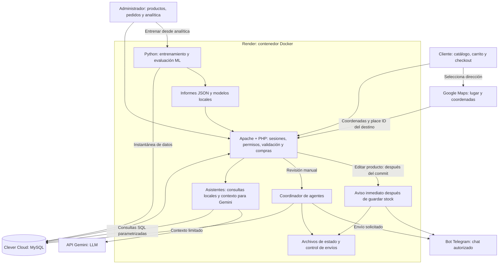
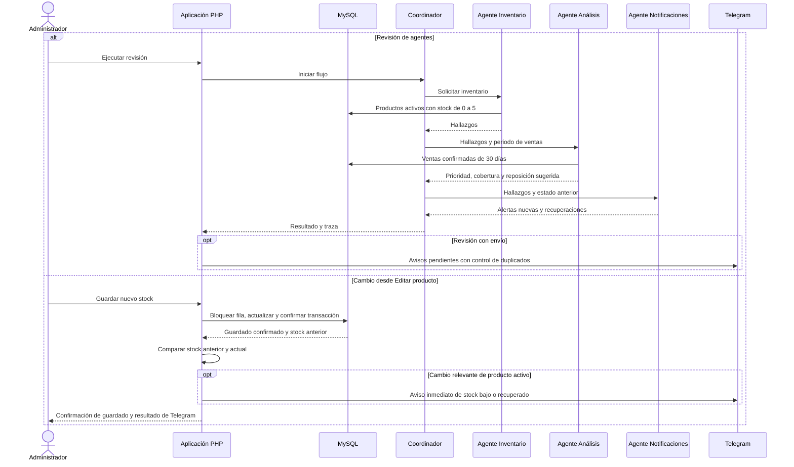

# Arquitectura de TechStore

## Vista general del despliegue

La aplicación contiene PHP y Python; MySQL es un servicio separado. Las claves
se configuran en variables del servidor. La clave de Maps usada en el navegador
debe restringirse por dominio y API. Las claves Gemini y Telegram permanecen
del lado del servidor.

## Coordinación de agentes y aviso inmediato

Son agentes especializados con reglas deterministas y mensajes estructurados.
No utilizan Gemini para decidir prioridades ni realizan compras autónomas.
El aviso inmediato de Editar producto es un camino adicional: no ejecuta todo
el coordinador ni calcula la recomendación completa sobre ventas históricas.
Solo se intenta después de guardar; un fallo del proveedor no revierte el stock.

## Diferencia entre ML, LLM y agentes

| Componente | Fuente y método | Resultado | Límite |
| --- | --- | --- | --- |
| ML | Datos de productos, clientes, pedidos y detalles; K-Means, clasificación y pronósticos temporales | Segmentos, riesgo de cancelación y proyecciones con métricas | Las métricas corresponden al conjunto académico; no garantizan resultados futuros |
| LLM | Gemini con contexto limitado y consultas locales exactas | Respuestas conversacionales | Depende de disponibilidad y cuota; una respuesta local no acredita una llamada a Gemini |
| Agentes | Stock y ventas históricas, reglas y coordinador | Prioridad, reposición sugerida y avisos | Cobertura histórica no equivale a una predicción ML de agotamiento |

## Persistencia y automatización pendientes en Render Free

- MySQL conserva los datos de negocio en Clever Cloud.
- Los archivos nuevos de uploads, informes ML, sesiones e historial de alertas
  están en el contenedor y pueden perderse con reinicios o nuevos despliegues.
- La tarea de Windows cada 15 minutos pertenece a la computadora local. No
  representa una tarea programada dentro de Render.
- El guardado de stock desde el administrador sí intenta el aviso inmediatamente.
  Cambiar MySQL con phpMyAdmin no ejecuta ese código PHP.
- El control de envíos usa archivos: no garantiza entrega exactamente una vez
  entre reinicios ni reintentos automáticos durables. Esas mejoras están pendientes.

Detalle de modelos: [ML.md](ML.md). Evidencias: [EVIDENCIAS_PRUEBAS.md](EVIDENCIAS_PRUEBAS.md).
