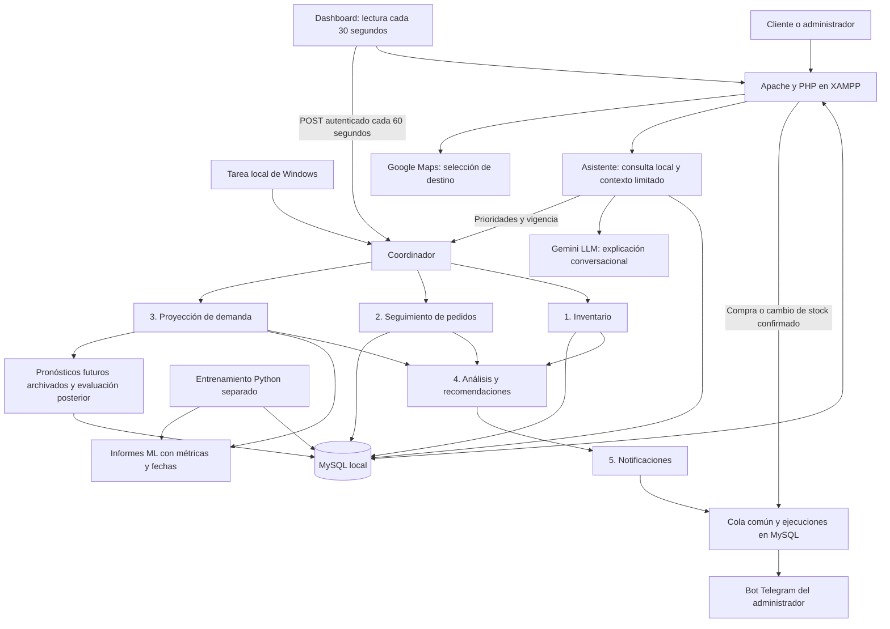

# Arquitectura de TechStore · versión local

Actualizada el 16/10/2026. Detalle: [Dashboard automático](DASHBOARD_AUTOMATICO.md).

Los cinco agentes tienen reglas y entradas concretas. Gemini explica resultados,
no modifica registros ni sustituye las predicciones de los modelos. El gráfico
representa dependencias; preguntar al asistente no ejecuta el coordinador: lee
su último resultado y advierte si está desactualizado.

La aplicación registra la transición de stock y la alerta en la transacción de
compra/edición; el envío externo se intenta después del commit. Las revisiones
usan el mismo registro para no repetir esa transición.

MySQL conserva ejecuciones, avisos y seguimiento de pronósticos. Los modelos y
los informes JSON siguen en disco local. No hay entrenamiento automático al
refrescar. El panel deja de solicitar agentes si se oculta o se cierra; la tarea
Windows opera por separado mientras el equipo y MySQL estén disponibles.

El proveedor puede fallar. Los rechazos permiten reintentos con espera; un timeout
incierto requiere revisión para no duplicar una entrega posiblemente aceptada.
No se promete entrega exactamente una vez. Las claves permanecen en el servidor,
excepto la clave Maps para navegador, que debe restringirse por dominio y API.

[Evidencias de pruebas](EVIDENCIAS_PRUEBAS.md).
