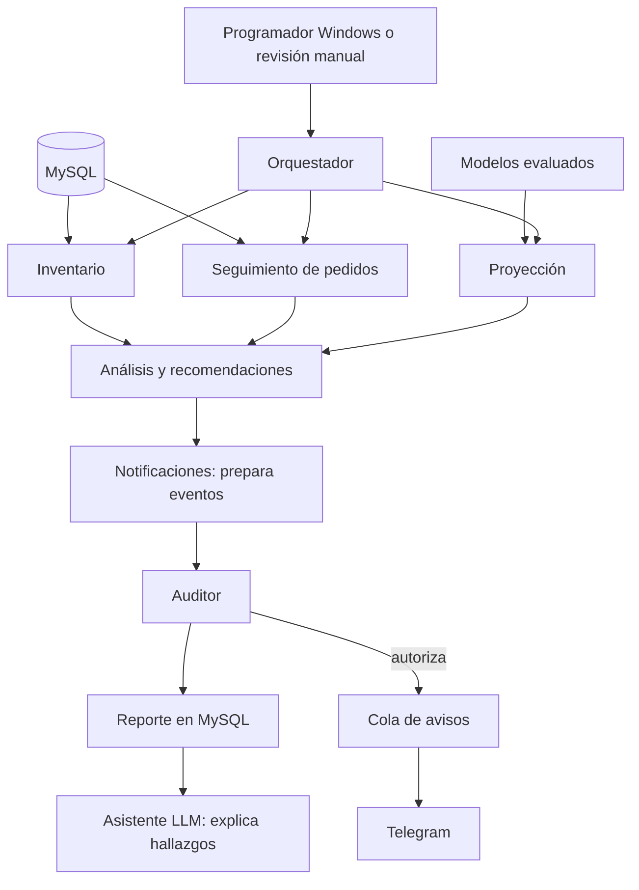

# ML, LLM y agentes: demostración y límites

## Dónde demostrarlo

1. `admin/dashboard.php`: indicadores de MySQL cada 30 s; ejecución opcional de agentes cada minuto mientras el panel está visible.
2. `admin/ml/control.php`: activar/desactivar el entrenamiento automático, elegir modelo automático o manual por ventas/pedidos, entrenar y consultar el historial persistido en MySQL.
3. `admin/ml/ventas_ia.php` y `pedidos_ia.php`: gráficos y tablas de comparación. Cinco familias: Ridge, Huber, Random Forest, Extra Trees y Gradient Boosting. Se añade Random Forest log y tres referencias: nueve candidatos en total.
4. `admin/ml/predicciones.php`: cinco vistas gráficas, lectura automática cada 30 s o actualización manual. La lectura no equivale a entrenar ni garantiza que el pronóstico haya cambiado.
5. `admin/operaciones.php`: pronóstico archivado ANTES del resultado frente a realidad de días terminados; centro de acciones con seguimiento humano.
6. `admin/agentes/index.php`: traza, auditor y reporte de tareas guardado en MySQL. `admin/gestion.php?tab=resumen`: horario y cola del resumen por Telegram.

## Elección y control del modelo

Se selecciona el menor MAE en validación temporal por ventanas; en empate se prefiere el método sencillo. La prueba posterior no participa en esa elección. Cada método se evalúa con los mismos bloques y sin introducir observaciones futuras en los rezagos. Se publican MAE, RMSE, R², WAPE y tolerancia ±20%, que no es certeza futura.

La selección manual mantiene la recomendación automática visible. El nuevo modelo se aplica al próximo entrenamiento, nunca cambia el informe anterior simplemente por guardar un formulario. Los gráficos incluyen la comparación de MAE y datos tabulados accesibles. Se advierte si el elegido no supera la referencia semanal en la prueba.

Una predicción útil orienta capacidad de despacho, turnos y presupuesto. Inventario combina demanda estimada con disponibilidad, plazos de proveedores y órdenes abiertas. Ningún porcentaje autoriza por sí solo compras ni cancelaciones.

## Qué significa automático y tiempo real

La interfaz lee automáticamente datos operativos y resultados persistidos cada 30 s. Los pronósticos diarios usan días COMPLETOS hasta ayer: no se presentan las ventas parciales de hoy como un día cerrado. La tarea local de Windows revisa cada 15 min y entrena una vez al cambiar el día o la configuración; después registra resultados y ejecuta los agentes. Entre intentos hay una hora de espera; un bloqueo compartido evita entrenamientos concurrentes. El botón permite entrenar antes de ese intervalo.

Esto es actualización periódica, no streaming ni entrenamiento por cada venta. Para una exigencia de inferencia instantánea intradía se necesita otro objetivo, variables por hora y evaluación específica; no se afirma que exista. El equipo y MySQL deben estar encendidos. Un entrenamiento interrumpido puede dejar “En curso”; se revisa antes de reintentar y el fallo no convierte informes antiguos en vigentes.

## Arquitectura de agentes

Hay un orquestador y seis agentes de tareas (siete componentes con rol): inventario, seguimiento, proyección, análisis, notificaciones y auditor. Supera el mínimo de cinco y contiene tres procesos de adquisición/análisis inicial más auditor. Cada uno tiene entrada, objetivo, salida y duración. El auditor comprueba identidad de resultados, contadores, stock negativo, duplicados/reposición y vigencia ML. Inconsistencias bloquean el envío del coordinador; informes viejos generan observaciones, sin suprimir avisos válidos de inventario. Los avisos inmediatos al guardar un producto tienen su propia validación transaccional.

Los agentes son componentes deterministas con funciones y mensajes estructurados; se configuran y prueban por rol, no se entrenan como redes neuronales. El ML sí se entrena; Gemini es el LLM externo. No se llaman APIs cinco veces para simular cinco agentes.

El reporte se crea en cada revisión, conserva el último por día en `agentes_estado` y cada ejecución en `agentes_ejecuciones`. El resumen diario adjunta el reporte reciente y lo envía por Telegram a la hora configurada, usando una clave única por día y la cola con estados/reintentos existente. Se eligió Telegram por indicación del usuario; correo SMTP no está implementado. Si el profesor exige correo literalmente, queda como integración adicional.

## Verificación reproducible

- `python -m unittest discover -s tests -p test_modelos.py`: comparación temporal, ausencia de fuga y elección manual efectivamente guardada en artefacto.
- `php scripts/pruebas_control_ml.php`: configuración, espera de reintentos, modos y bloqueo del auditor con datos inconsistentes.
- `php scripts/pruebas_multiagentes.php` y `pruebas_cinco_agentes.php`: intercambio, idempotencia, recuperación y auditor.
- `php scripts/pruebas_centro_operaciones.php`: archivo prospectivo, exclusión de días abiertos y seguimiento humano.
- No se inventan resultados futuros para llenar el panel. La evaluación prospectiva requiere esperar el cierre de los días pronosticados.
